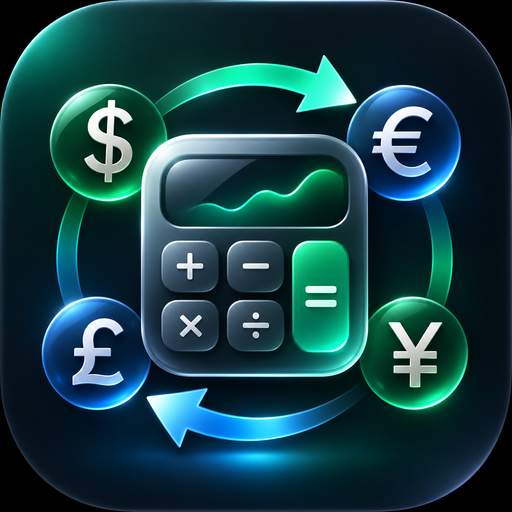

# Калькулятор для Android



Простой и аккуратный калькулятор на Kotlin без сторонних библиотек.

## Возможности

- Сложение, вычитание, умножение, деление: `+ − × ÷`
- Скобки (одна «умная» кнопка `( )` сама решает — открыть или закрыть) и автозакрытие скобок при `=`
- Проценты: `50%` = `0.5`, `200 × 15%` = `30`
- Унарный минус: `5 × −2`
- Точная десятичная арифметика (`BigDecimal`): `0.1 + 0.2 = 0.3`
- Предварительный результат прямо во время ввода
- `⌫` стирает символ, долгое нажатие — очищает всё
- Светлая и тёмная тема, сохранение выражения при повороте экрана
- Понятные ошибки: «Деление на ноль» и т. п.

## История

- Лента прошлых вычислений всегда видна над текущим выражением — новые снизу.
- **Нажмите** на запись — её результат вставится в ввод: после `5 +` получится `5 + 42`,
  а набираемое число заменится результатом. Отрицательные числа сами берутся в скобки: `3 − (−5)`.
- **Удерживайте** запись — меню: *вставить результат*, *вставить выражение* (в скобках, если
  нужно), *копировать*, *удалить*.
- Кнопка 🕘 разворачивает историю на весь экран, кнопка ▦ или «Назад» возвращает клавиатуру.
  Там же — очистка истории (с подтверждением).
- История сохраняется между запусками приложения, одинаковые вычисления подряд не дублируются.

## Заметки, плитки и поиск

- Удерживайте запись истории → **Добавить заметку** (например, «аренда»). Заметка видна
  в ленте и на плитке, копируется вместе с вычислением.
- Кнопка 🕘 открывает историю **плитками**: новые сверху, на каждой — заметка, выражение,
  результат и время («Сегодня, 14:05», «Вчера», дата).
- **Поиск** над плитками — по заметке, выражению и результату. Несколько слов ищутся вместе
  («аренда 2026»), регистр, «ё/е» и «,/.» не важны. Кнопка **★ Заметки** оставляет только
  записи с заметками.

### Сколько хранится

- Записи **с заметками хранятся всегда**.
- Записей **без заметок** — последние 200; более старые удаляются автоматически.
- «Очистить историю» удаляет только записи без заметок; удалить и заметки можно
  отдельной кнопкой «Удалить всё» (с повторным подтверждением).

## Быстрая сумма (Σ)

Лента сложения: вводите числа подряд → «Готово», итог крупно сверху.

- С подписью: `хлеб 1.9`, `5.40 молоко`; с умножением: `молоко 2×2.35`; с минусом: `скидка -5`.
- Кнопка «абв / 123» — цифровая клавиатура (быстрее) или с буквами (для подписей).
- Нажатие — не учитывать строку, свайп — удалить с «Отменить», удержание — изменить.
- «В калькулятор» — итог в пример, лента в историю; «Поделиться» — лента текстом.

## Покупки

Кнопка **Покупки** на главном экране — списки покупок плитками с прогрессом «куплено 5 из 12».

- Добавление строкой внизу: пишете товар → «Готово», клавиатура остаётся для следующего;
  подсказки из прошлых покупок. Можно с ценой и количеством: `Молоко 2 × 2.35`, `Яблоки 1.5 кг`.
- Нажатие — вычеркнуть (уходит в «Куплено»), свайп — удалить с «Отменить»,
  удержание — изменить название, количество, цену.
- Итог, потрачено и осталось; «В калькулятор» вставляет итог в пример.
- Снять все отметки (повторный список), удалить купленное, поделиться списком текстом.

## Конвертер валют

Кнопка **Валюты** над экраном. Строки BYN, USD, EUR, BTC — введите сумму в любой, остальные
пересчитаются сразу (можно писать выражения: `100+50`). Текущее число из калькулятора
подставляется автоматически, кнопка **В калькулятор** возвращает выбранную сумму обратно.

- USD и EUR — официальный курс **Нацбанка Республики Беларусь** (api.nbrb.by).
- BTC — мировая цена в долларах (CoinGecko, запасные: Coinbase, Binance), пересчитанная в BYN
  по курсу НБРБ.
- Курсы обновляются при открытии (если старше часа) и кнопкой ⟳; последние сохраняются,
  так что без интернета конвертер тоже работает.

### Курсы банков

- Кнопка **«Курс: …»** — выбор, по какому курсу считать: НБРБ, **лучший курс в банках**
  или конкретный банк (в списке сразу видны его покупка/продажа доллара).
- Для банков — переключатель **«Покупаю валюту»** (курс продажи банка) /
  **«Продаю валюту»** (курс покупки банка).
- Блок **«Курсы банков Минска»** (USD или EUR): минимальная и максимальная покупка и продажа
  с названиями банков и таблица всех банков; выгоднейшие курсы выделены, нажатие на банк
  выбирает его курс.
- **Нажмите на курс** в таблице (например, зелёный — лучший) — откроется список отделений
  этого банка с таким курсом; нажатие на адрес открывает его на карте.
- Источник — таблица банков на myfin.by; если она недоступна — официальные API
  Беларусбанка и Альфа-Банка. У банка курс указан лучший по Минску (в разных отделениях
  он может отличаться).

## Оформление

ⓘ → «Оформление»: **как в системе** (по умолчанию — светлая или тёмная вслед за телефоном),
**светлая** или **тёмная**.

## Инструкция и о приложении

Кнопка ⓘ на главном экране открывает понятную инструкцию по всем функциям
и информацию о приложении.

**Разработчик:** Mikhail Pipchanka

[Политика конфиденциальности](PRIVACY.md) — также доступна в приложении (ⓘ → «Политика конфиденциальности»).

## Как получить APK

**Скачать последнюю версию:**
https://github.com/mishpip31-droid/android-calculator/releases/latest/download/calculator.apk

Откройте ссылку на телефоне и установите файл (разрешите установку из неизвестных источников).
Каждый push в основную ветку собирает новую версию и публикует её в *Releases*;
новые версии ставятся поверх старых, история сохраняется.

**Локально:** откройте проект в Android Studio или выполните

```bash
./gradlew assembleDebug        # APK: app/build/outputs/apk/debug/app-debug.apk
./gradlew testDebugUnitTest    # юнит-тесты
```

Требования: JDK 17+, Android SDK (compileSdk 35). Минимальная версия Android — 7.0 (API 24).

## Структура

| Файл | Назначение |
|---|---|
| `Evaluator.kt` | Разбор и вычисление выражения (рекурсивный спуск) |
| `Calculator.kt` | Логика ввода: какие нажатия допустимы, «=», предпросмотр, вставка из истории |
| `History.kt`, `HistoryStore.kt`, `HistoryAdapter.kt` | История: логика, заметки, сохранение, лента и плитки |
| `Currency.kt`, `RatesRepository.kt`, `ConverterActivity.kt` | Конвертер: пересчёт, загрузка курсов, экран |
| `BankRates.kt`, `BankRatesRepository.kt` | Курсы банков: разбор, мин/макс, загрузка |
| `Shopping.kt`, `ShoppingRepository.kt`, `Shopping*Activity.kt` | Списки покупок |
| `MainActivity.kt` | Экран и привязка кнопок |
| `res/layout/activity_main.xml` | Разметка экрана и клавиатуры |
